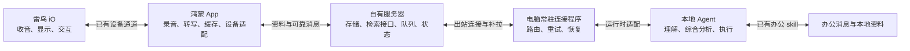

# 雷鸟 iO 独立鸿蒙 App 产品需求文档

版本：v0.4｜更新：2026-10-24｜状态：Web 原型已确认，Android Agent 工作区进入真机验证

本文为当前需求唯一主文档，取代 v0.1。需求状态分为【确认】用户明确提出、【方案】本轮建议的产品规则、【验证】需要设备或运行时验证。本文定义产品，不表示新增能力已交付。

2026-10-19执行补充：【确认】先复用Turbo-IO官方安卓宿主构建完整APK，安卓成熟后再回到现有鸿蒙工程；阶段出口见[安卓优先计划](./ANDROID-FIRST-PLAN.md)。**2026-10-20最新确认：先登录再使用。** 启动进入原厂账号流程，已存在有效会话时沿用登录状态；未登录时不提供本地体验或自有主页的跳过入口。此前2026-10-19免登录偏好及对应测试保留为历史，现由本条替代。眼镜配对/设备认证、服务器身份与任务授权继续独立核验；雷鸟账号不替代电脑Agent授权。一分钟原生建议卡、三条核心流程、日常稳定及原有基础体验门槛均保留。

## 1. 产品定位与不可退让的原则

2026-10-23 界面评审补充：【确认】用户已完成 Web 原型评审，并明确要求“就按这个改造 APP”。原先仅做 Web 的阶段结束；保留原厂入口、登录与基础功能，在现有 Agent 入口内迁移原生页面。原型及评审记录见 [Agent 工作区 v2](../prototypes/agent-workspace-v2/README.md)。连接列表统一进入「查看连接」，在详情内暂停或恢复连接；任务单独提供暂停并追加指示，收到 Agent 回执才显示暂停或继续。任务状态筛选保持内容区高度与滚动位置。日期中有记录的日期显示圆点；账号设备入口文案为「回到原厂 APP」。

【确认】新任务设置默认 Agent 和默认工作区，后续 CLI 登记可设为默认，眼镜 AI 主动唤起可直接使用该目标；已有问题的回复仍回原任务。【方案】默认目标不可用时等待或由用户明确更换，不自动改投其他 Agent。上述 CLI、主动唤起及任务控制接口仍待实现，原型回执仅为演示。

【实现进度，2026-10-23】Android 已接入「任务 / 资料 / 设置」三页与近黑、深绿、青绿主题；列表保留真实状态和原任务回复路由。已登记连接可设置默认 Agent / 工作区，本次委托可临时换目标；修改默认不改变既有任务。dev55 /10477 将资料读取与远程上传解耦：打开资料或选择日期，按当前原厂账号读取该日列表、正文并复核列表，保存到本机资料库；上传配置关闭或过期不阻断查看。日期圆点表示本机已有资料，重复刷新不重复创建，空日期不删除既有正文。文字支持 Word、Markdown、TXT 导出。真机在远程配置过期时读取 23 日 19 份正文（收尾时原厂新增后为 20 份）、重复刷新及空日期保留已核对；源码、装机与整体验收分开记录，见 A23-UI02 和[dev55 当天智记读取证据](../../rebuild/android-app/material-day-read-dev55-2026-10-23.json)。

【实现进度，2026-10-24】dev76 已接通智记文字自动增量：按原账号读取今天和一个补查日期，合并经核对的同源分段；每批最多 16 个事件，有已存进展时一分钟后继续，真正失败才退避。已在真机后台自动上传真实文字，凭据限期及正文回读证据见[本批交付](../../rebuild/android-app/r4-auto-text-dev76-2026-10-24.json)。账号不可用、开关关闭或凭据到期时停止，待传正文保留；不保证绕过 Android 后台限制。

【实现进度，2026-10-24 dev85】原音页退后台隐藏旧连接和候选，回前台及系统文件选择器返回先重核账号；保存与手动备份分别限定已核对账号和页面连接。手机未配置状态的往返已自测，未提前启用真实原音。

【尚未交付】任务暂停与追加指示需要电脑 Agent 的控制协议及回执，用户已暂缓本项；界面只保留明确标注未发送的本机指示草稿。原音手机导出已在 dev80 正常页面通过真实片段保存和独立文件校验，听感及连续保存稳定性尚未验收。远程原音固定 72 小时保存已完成服务端源码自测，dev84 已装独立配置、自动队列与状态页；音频服务及独立到期清理现已上线，合成公网 TLS 通过；正式原音授权及真实手机上传/回读未完成；权威删除、CLI 登记默认及眼镜主动调用默认目标仍未交付，不能把文字同步标作原音完成。

【确认】在雷鸟官方 App 基础体验完整对齐的前提下，打造原生鸿蒙独立 App，让眼镜成为用户电脑中本地 Agent 的随身输入、消息展示和决策终端。

基础功能可用、操作顺畅、连接可靠、录音与智记体验不退步，是正式交付门槛。增强能力建立在这一基础之上，不能用“先做几个特色功能”替代基础体验，也不能因电脑 Agent 不在线导致原有录音、智记、设置等无法使用。

【确认】智能分析和任务执行的中心在电脑本地 Agent。用户已购买服务器，服务器负责资料持久保存、按需查询、消息中转和离线队列。日常办公消息与日常对话由本地 Agent 综合分析，形成待办、建议和执行安排。

【确认】优先沿用原厂眼镜固件，通过手机及电脑侧适配实现增强。产品层先定义理想交互，实现层再验证原厂通道可承载的形式；不得为了方便编写 PRD 就假定能任意改眼镜界面。

【确认】现有录音链路已实现，大部分硬件设置接口可调通。以用户提供的最新进展作为本版基线；复用既有成果，新增集成时做针对性回归。旧资料中“录音未完成”的表述不能作为要求重建录音的依据。

## 2. v0.1 的实质修正

| 旧定义 | 本版定义 |
| --- | --- |
| 核心闭环先交付，基础功能后补 | 正式交付必须通过官方基础体验对照；开发可分步，但实验版本不能冒充完整替代 |
| 服务器承担主要转写、记忆分析和智能处理 | 手机承担语音转写入口；服务器存储及中转；本地 Agent 负责综合分析与任务执行 |
| 把服务器提醒主要理解为记忆触发的主动建议 | 重点是正在执行任务的 Agent 请用户决策，并在回复后继续原任务 |
| 眼镜反馈主要是确认/拒绝 | 包含多选项单选、二次澄清、自由语音回复、稍后处理，以及任务上下文恢复 |
| 几十秒同步作为默认核心目标 | 语音指令与决策回复优先低延迟；日常智记按可持续的增量同步处理，具体周期待测 |
| 智记仅充电时转写 | 持续记录时也应产出文字，充电用于补处理和精修，不能成为白天文字可用的必要条件 |
| 原型风格沿用暖白深绿 | 重新确定原生鸿蒙设计方向：克制的沉浸光感材质、清晰信息层级、多设备自适应 |

## 3. 已确认与尚未确认的边界

| 内容 | 状态与说明 |
| --- | --- |
| 官方全天智记现状 | 【确认：用户实用反馈】每天总结语音转录文字，不区分说话人，智记不能按用户需要保存/上传。本描述限定于用户当前使用体验，不泛化为全部版本 |
| 自有智记增强 | 【确认】保留可查询资料、区分说话人、支持服务器同步、本地 Agent 查询与综合分析 |
| Agent 运行位置 | 【确认】在用户电脑运行；本地运行不等于模型推理必须离线，模型服务沿用 Agent 自身配置 |
| 手机语音入口 | 【确认】眼镜说话，经手机转为文字，经服务器交给电脑 Agent |
| 多 Agent 接入 | 【确认】封装成通用 skill 能力；兼容边界按工具与运行时能力声明，不能声称仅有提示词就能控制任何终端 |
| Hermes | 【确认】优先研究候选；hook/网关/常驻程序的具体组合属于【方案】 |
| 鸿蒙体验 | 【确认】原生特性、美学和一端开发多端部署；首批具体设备范围仍需细化 |
| 固件 | 【确认】原厂固件优先；若确需改固件，应形成独立决策，不能作为隐含前提 |
| 上传与留存数值 | 【确认，2026-10-23】远程原音固定保存 3 天，本阶段不提供时长调整；【方案】上传节奏和 72 小时计时起点见第 7 节，未作为已交付能力 |

## 4. 三条独立但互通的核心流程

### A. Agent 了解我的日常

1. 用户开启智记，眼镜采音，手机沿用现有链路接收并保存。
2. 手机持续生成带时间的文字，补充分段与说话人标签；远程完整原音固定保留 3 天，本阶段不提供留存时长调整。
3. 已稳定的文字增量上传服务器，原音按独立策略同步；电脑离线不影响保存。
4. 本地 Agent 使用 skill 按日期、时间、关键词、人员标签、项目或增量游标查询资料。
5. Agent 通过既有办公消息 skill 查询工作沟通，在本地结合日常对话分析。
6. 输出“发生了什么、有哪些承诺/冲突/待办、建议如何安排”，附证据与不确定项。
7. 分析结果可回存服务器并在 App 查看；需要提醒时再使用眼镜消息能力。

验收示例：办公消息说周五交付，口头讨论改为周四；Agent 能引用两处来源提醒时间冲突，并允许用户确认实际截止日。

### B. Agent 需要我做决定

1. 任一本地任务遇到需要用户选择的事项，Agent 调用统一“向眼镜提问”能力。
2. 创建包含问题、选项、推荐理由、期限和原任务引用的交互请求。
3. 服务器持久化，手机收到后按忙闲、勿扰和优先级安排展示。
4. 用户通过旋钮、经验证的头部动作选择，或直接语音补充答案。
5. 手机绑定当前问题，上传结构化选择或转写文字；显示提交状态。
6. 本地连接程序把答案投递回发起问题的 Agent 和任务；任务继续执行。
7. 眼镜收到“答案已送达 / 任务已继续 / 结果已完成”等适当反馈。

验收示例：Agent 整理一份报价，问“沿用上版还是按新价格？”用户回答“按新价格，但运费沿用上版”，该完整条件回到原任务，不能被压成简单“同意”。

### C. 我用一句话指挥电脑 Agent

1. 用户使用已支持的助手入口唤起眼镜助手。
2. 眼镜收音，手机转写，镜片显示识别文字或关键内容。
3. 普通明确指令在用户结束说话后提交；含糊或影响较大的指令按规则澄清。
4. 服务器把指令放入指定电脑、Agent 和会话的收件队列。
5. 本地连接程序投递给正确的运行会话，或按授权创建新会话。
6. Agent 用日常资料与办公工具执行；中途需要判断时转入流程 B。
7. skill 指导 Agent 用适合眼镜的短消息汇报，完整内容在手机/电脑保留。

验收示例：用户说“结合今天和张工的讨论，把明天会议要点整理到这个项目里”；Agent 查询日常对话与项目资料，按当前会话的项目上下文创建产物并返回结果。

## 5. 系统职责与离线边界

| 部分 | 必须负责 | 边界 |
| --- | --- | --- |
| 眼镜 | 已有交互、采音、短内容显示 | 不预设运行任意 App、网络服务或自定义弹窗 |
| 鸿蒙 App | 官方功能对齐、手机转写、录音存储、说话人整理、队列、眼镜交互适配 | 基础录音与历史查看不依赖电脑在线 |
| 自有服务器 | 用户设备身份、资料存储、按条件检索、消息队列、状态与确认去重 | 不负责日常自主决策或电脑任务执行；可有轻量索引，不默认部署另一个 Agent |
| 电脑连接程序 | 主动连接服务器、接收指令、路由会话、上传进度、恢复未完成交互 | 网络桥接与执行权限分离；默认无需把本地终端暴露公网 |
| 本地 Agent | 办公消息查询、日常资料理解、任务规划、执行和最终回复 | 不假设其提示词能提供常驻收信能力 |
| 通用 skill | 教 Agent 何时查资料、何时提问、怎样回复、怎样解释状态 | 需要实际 HTTP/CLI/MCP 工具及凭据作为执行基础 |

【方案】电脑离线时，App 保持官方等价的日常功能与基础问答路径；增强委托排队并显示“等待电脑”。基础问答可复用现有模型接入，但不得伪装成电脑 Agent，也不得虚报电脑任务已执行。

## 6. 官方体验对齐清单与发布门槛

“对齐”按场景、步骤、反馈、稳定性、性能和异常恢复衡量。功能语义及关键交互保持熟悉，手机视觉可按鸿蒙重设计。原 App 的缺陷不要求复刻。

| ID | 基础范围 | 对齐要求 | 基线来源/待补内容 |
| --- | --- | --- | --- |
| BASE-01 | 首次连接、已绑定重连、权限引导 | 成功条件清晰、取消可恢复、断连自动处理、不过度要求重复配对 | 现有实现 + 原 App 走查 |
| BASE-02 | 电量、状态、设备设置 | 展示真实值，修改有反馈，离开页面不丢状态；覆盖现有硬件设置 | 用户确认大部分接口可用；逐项登记 |
| BASE-03 | 主动录音 | 起停、回放、记录管理、转写、总结、导出按参考版逐项对齐 | 已实现录音链路复用 |
| BASE-04 | 全天智记 | 开启/暂停、后台记录、当天回顾和每日总结可独立使用 | 用户实用反馈 + 实机走查 |
| BASE-05 | AI 助手 | 原有唤起、问答、显示、继续与退出体验保持，增强接本地 Agent | 参考版入口与手势待登记 |
| BASE-06 | 看板、日程、待办 | 信息更新、展示、完成状态与官方一致或改善 | 官方公开目录；详细动作待走查 |
| BASE-07 | 实时字幕/翻译 | 已有模式、开始/结束、文字展示与错误反馈对齐 | 语言范围与服务权益按参考版登记 |
| BASE-08 | 提词器 | 文稿管理、导入、开始、滚动/暂停、退出与设备反馈 | 原 App 走查 |
| BASE-09 | 手机通知及回复 | 按参考版覆盖来源筛选、显示、勿扰、回复；鸿蒙权限路径单独核实 | 平台可用性待验证，不能静默删减 |
| BASE-10 | 其他设置与维护 | 唤醒/头势/旋钮、显示、隐私、帮助、升级、账户与备份迁移逐项盘点 | 仅实际存在者纳入对照；未观察项不宣称原 App 支持 |

完整对照表每行必须包含：参考 App/系统/固件版本、原操作步骤、原反馈、本 App 操作、实测证据、差异、状态。不得把“待走查”填为“已对齐”。

正式替代版门槛：参考版所有确认的基础场景逐项通过；存在平台不可达项时列出影响并由用户决定是否接受版本范围，不能自行把需求降为后续功能。激活、官方历史导入、账号权益和固件升级也要登记边界；需要官方 App 的维护环节应如实标明。

开发可分为实验包和正式替代版。实验包用于逐步验证增强，不降低正式版要求。

## 7. 录音与全天智记增强

### 7.1 录音资料模型

【确认】复用已有录音，不改变已验证的收音协议。主动录音与智记共用资料管理基础，分别保留模式、时间和会话归属。

- 原音、逐句文字、说话人、摘要、待办、上传状态独立存在；一种处理失败不妨碍其他资料查看。
- 原音可回放，文字可跳转时间点；无原音时仍可查看和导出文字，并明确不能回放。
- 分段保留起止时间和完整性；录音开始/结束、手动暂停、断连缺口必须可区分。
- 文本更正和重新转写建立版本；摘要和查询结果引用正确版本。
- 智记与会议录音同一时段以关联关系去重，不在每日总结里把同一内容算两次。

### 7.2 说话人区分

【确认】全天智记必须支持区分说话人，尤其要区分“我说的”和“他人说的”，改善承诺、责任人和待办归属。

【方案】先做一段会话内的说话人分离，再提供用户校正和跨会话关联；跨天自动识别姓名属于增强，不能从“分离了两个人声”直接推出。

- 初始标签为“我 / 说话人 A / 说话人 B / 未确定”；“我”仅在有可靠依据时使用，否则也保留匿名标签。
- 允许合并误拆标签、拆分误合标签、给当前会话标签改名，明确“仅此段”还是“以后关联”。
- 低置信、交叠发言和无法分离的部分必须标注；不因骨传导或 VAD 字段存在就直接保证身份识别。
- 重新分析时沿用用户确认信息，不把用户更正覆盖回旧识别结果。
- Agent 查询返回说话人来源和置信状态；“别人提出的建议”不能自动记成用户承诺。

### 7.3 每日总结与按需查询

- 保持每日总结体验，支持历史日期、重新生成、编辑/附注和导出；生成时展示当天资料覆盖范围。
- 总结分为事实回顾、待办候选、待确认问题与建议；可以折叠，不能用长篇总结替代原文。
- 电脑在线时，本地 Agent 可生成结合办公消息的综合总结；电脑离线时保持 App 基础日记路径，之后可增补综合版并说明来源。
- 支持时间段、关键词、说话人标签、项目标签过滤；Agent 可按游标仅获取新增/更正/删除资料。
- 返回命中片段、上下文、来源时间、同步新鲜度、可用原音引用；无资料返回无资料，不凭摘要补造原话。
- 标签与待办提取可由本地 Agent 后续回填，不要求服务器自己“理解生活”。

### 7.4 转写、上传与功耗

【确认】语音指令在手机完成转写后再到服务器。手机端本地识别优先复用现有能力；是否允许 App 调用外部 ASR 服务由配置明确，不能把“手机转写”默认解释为音频必须外发。

【方案】把指令低延迟通道、智记文字通道和原音归档通道分开调度：

| 通道 | 行为 | 建议初始目标 |
| --- | --- | --- |
| 指令/决策回复 | 结束说话即提交稳定文字，优先于归档上传 | 按第 15 节的低延迟门槛验收 |
| 智记文字 | 边记录边生成稳定片段，增量持久化和上传 | 正常条件下 1–5 分钟可查询；后台积压可见 |
| 原始音频 | 本地可靠保存，按片段校验上传，可选择仅 Wi-Fi | 不阻塞文字与消息；上传周期可配置 |
| 精修处理 | 说话人精修、复杂整理、补转写、原音批量归档 | 可在充电/空闲时运行，后续结果带版本 |

【方案】取消“仅充电才有智记转写”作为默认逻辑。发热/低电/后台限制时降级为“原音已保存、文字稍后补齐”，显示积压原因。记录可靠性优先于重模型；不允许后台默默长期无文字。

### 7.5 保存、导出与删除

- 智记文字、说话人标签和总结支持保存及 Markdown/结构化格式导出；原音按权限和留存策略导出。
- 【确认，2026-10-23，替代此前留存可配置方案】远程原音固定保存 3 天，本阶段不提供时长调整；原音与文档均须支持导出到手机。远程原音到期不删除文字、摘要或已经导出的手机文件。
- 【方案】远程持久保存成功起计算 72 小时，并显示具体到期时间；上传中的片段不启动远程到期计时。本机缓存清理另行设计，不把远程到期等同于删除手机原始资料。Android 已实现 Word、Markdown、TXT 文字导出；dev80 已接部分原音本机保存和手机导出，真实 ZIP/Ogg 及系统保存路径已验证，连续保存仍有中断待修。原音听感沿 A24-A01，其他体验沿 A23-UI02 分别记录。
- 【方案，2026-10-23】默认自动同步；稳定文字每 1 分钟合并上传，完整原音片段保存后上传，断网或后台受限时保留队列并在恢复后补传。最近成功时间仅在服务器确认后更新。进度详情提供补充的「立即同步」操作，设置提供明确开关；关闭只停止新上传，不删除既有资料、不延长原音到期、不撤销 Agent 对已有资料的查询。2026-10-24 dev76 已安装，文字自动增量、日期补查、已确认历史收缩及未确认旧正文的原子撤销已接通；已完成服务部署回退演练和真机后台文字上传。dev84 已接原音客户端自动调度与独立启用，但音频服务及独立清理已上线，尚无正式原音授权或真实手机上传回读，长时间后台稳定性不据此认定通过。
- 默认不清理尚未可靠上传的资料；需要释放空间时显示占用、风险和可操作方案。
- 选择保留原音时，清理手机原音之前须收到服务器持久化及校验确认；只有转写成功不够。
- 删除在增量查询中发布删除标记；本地 Agent 已缓存资料须按约定处理撤回，不能承诺撤销已经发往外部的所有产物。
- 暂停记录、暂停上传、关闭 Agent 可查询权限分别控制，提示既有队列是否继续处理。

## 8. Agent 决策请求：完整交互规格

### 8.1 三种消息类型

| 类型 | 用途 | 用户行为 |
| --- | --- | --- |
| 通知 | 进度、完成、失败或提示 | 查看/关闭，默认不阻塞任务 |
| 选择请求 | 确认、二选一、多选项中的单选 | 选择一个选项，或改用语音说明 |
| 自由回复请求 | 需要名称、条件、补充要求等 | 语音回答或在手机输入 |

【方案】首版选择请求支持 2–4 个清晰选项，不做复杂多选表单；更复杂问题拆成少量步骤或转手机，但保留眼镜可语音回答的路径。Agent 可给推荐项及一句理由，推荐不等于已选择。

### 8.2 一张请求必须包含什么

- 来自哪个 Agent/电脑、哪个任务、当前在做什么。
- 一个具体问题、可选项和选择的后果；必要时提供可展开的简短上下文。
- 是否正在等用户、何时失效、忽略后会怎样。
- 支持的输入方式：旋钮/头势/语音/手机，依实际设备能力显示。
- 稳定的请求 ID、请求版本、关联会话和任务 ID；这些字段供系统关联，普通用户无需看到。

示例内容：

> 项目资料 · 等你决定  
> 明天的会议材料采用哪一版？  
> ① 最新版（推荐） ② 上周版 ③ 语音补充  
> 选后继续整理，尚未发送给其他人。

这是产品示意，不能当成原厂眼镜已经支持可任意绘制的选项框。

### 8.3 旋钮与头部动作

【方案】旋钮用于移动当前选项并确认；原头势候选为点头确认、摇头返回/暂不处理，确切映射以原厂交互和回传实测为准。“返回、拒绝、取消任务”是不同语义，不能全部映射为一个关闭动作。

【确认：2026-10-20补充，Agent卡优先于上述头势候选】Agent卡复用待办卡通道但会影响实际任务。若用户启用了待办的点头/摇头确认，显示Agent卡期间临时关闭该功能，改用明确的旋钮/按键点击或手机点击交互；收到本次选择并结束卡片后恢复原值。先可靠保存原设置并确认关闭成功，再开放可产生任务答案的卡片；关闭无法确认时留在手机待答，不开放可能误触的眼镜确认。

临时修改必须绑定原设备和本张卡，超时、撤回、断连及App重启仍需完成清理与恢复，不能永久改变普通待办偏好。用户期间主动修改设置时不得盲目覆盖其新选择；恢复失败需保留待恢复状态。实现前核对官方具体开关，不能把抬头亮屏等无关头部功能一并关闭。此项在实际Agent卡接线时实现，既有一分钟隔离卡的验收和免测边界保留。

- 有效输入窗口仅绑定当前显示的请求与版本；切卡后旧动作不影响新卡。
- 同时只有一张卡拥有输入焦点；新消息默认不抢走正在回答的卡。
- 用户选择时立即给予本地可实现的反馈，随后分别显示“已提交”和“Agent 已收到”。
- 普通头动、重复动作、迟到事件不触发新任务。只收到语义操作时，记录确认/拒绝，不伪造原始头势类型。
- 对超过屏幕能力的选项使用分页/逐项展示候选方案，始终保留当前项与总数；是否能实现需验证。

### 8.4 语音回复

【确认】决策请求必须允许自由语音回答，不能仅有“是/否”。

- 有正在展示或用户明确打开的请求时，语音回复归入该请求；没有活动请求时进入助手会话。
- 多个请求排队时，用户说“回复那个报价问题”需要选定目标；不按“最近收到”盲目归属。
- 明确说出选项可映射为 option_id；带附加条件的语句同时保留原文，不能丢弃“但是”“先不要”等限制。
- 识别不清时允许重说、取消或手机修正；不能自动选推荐项。
- 普通回复展示转写后按明确提交动作或约定自动提交策略完成；涉及外部影响的决定需确认完整动作与对象，默认不因说话结束直接执行。
- 回复必须含 request_id、版本和完整转写；排队、超时、取消都要可见。

### 8.5 队列与生命周期

状态：待发送 → 服务器已保存 → 手机已收到 → 待展示/展示中 → 用户回答已保存 → 已交给 Agent → Agent 已确认接收 → 原任务继续。过期、撤回、取消、拒绝和传递失败为独立终态或异常态。

- 手机/眼镜短暂离线时排队；过期后不再弹窗，答案不能继续提交旧请求。
- 关闭卡片只表示不再展示，不自动解释为拒绝或任务取消。
- “稍后”保留待处理项，可设提醒；无回应默认保持待决，不默认同意。
- 用户在手机和眼镜同时回答时，服务器原子接受第一个有效版本的答案，另一端显示已处理。
- Agent 更改问题或选项时产生新版本；已过期版本的答案拒收并提示查看新问题。
- 对同一问题的重复通知合并；频繁进度更新不逐条打断。默认仅请求决策、完成、失败主动提醒，常规进度进入记录。
- 电脑崩溃或会话丢失后保留答案，标记“未能恢复原任务”；不能把答案投给另一个新任务冒充继续执行。

## 9. 眼镜语音指挥本地 Agent

### 9.1 会话路由

- 初次配置选择默认电脑、默认 Agent，以及“新会话/继续当前会话”的默认策略。
- 一条指令必须绑定 agent_id、session_id 或明确的 create_session 意图；“当前”指最近明确绑定的会话，不是桌面上恰好获得焦点的窗口。
- 正在回复请求时，以请求绑定的任务为准；显式说“新任务”可退出该请求的输入上下文，但不替它作答。
- 允许手机选择项目与会话；眼镜显示可辨认的短名称，避免在错误项目执行。
- 忙碌时区分补充原任务、排队新任务、请求取消；运行时不支持插入消息时明确排队，不假装立即生效。

### 9.2 用户反馈

- 至少区别“手机正在听”“已识别”“等待电脑”“已送达会话”“执行中”“等你决定”“完成/失败”。
- 本地 Agent 的回答经 skill 压缩为眼镜适合阅读的短段，长产物给标题和摘要，在手机/电脑展开。
- 首次确认接收、需要用户输入、完成和失败主动反馈；高频日志只在详情中查看。
- 眼镜内“停止”请求需区分停止收音、停止朗读/展示、取消电脑任务；不能共享一个含糊动作。
- 任务取消以运行时回执为准；已经执行的外部副作用无法靠取消消息自动撤回。

### 9.3 电脑离线与恢复

- 电脑连接程序定期报告在线、可接收任务、支持能力与版本；仅有网络心跳不能证明 Agent 会话可执行。
- 用户可选择排队或取消；提交后显示有效期。恢复时过期指令进入待确认，不自动补执行。
- 默认一个本地会话顺序处理指令；多个 Agent 可独立排队，但不能因网络重试重复执行。
- 常驻连接程序自动重连并恢复游标；重启后核对任务状态，执行结果不明时先对账，不盲目重发动作。

## 10. 通用 skill 与 Hermes 接入要求

【确认】未来交付可被不同 Agent 使用的技能包；本轮只定义技能能力与契约，不安装 skill、不改电脑后台。

### 10.1 技能能力契约（建议命名，尚非已存在 API）

| 能力 | 输入 | 输出/行为 |
| --- | --- | --- |
| daily.search | 时间、关键词、说话人/项目、分页 | 命中原文、来源、上下文、覆盖和新鲜度 |
| daily.changes | 上次游标、范围 | 新增、更正、删除及新游标 |
| daily.get | 记录 ID、版本 | 原文详情、说话人、摘要、可用附件 |
| glasses.notify | 会话/任务、短内容、优先级、期限 | 持久消息 ID及后续送达状态 |
| glasses.ask | 问题、选项、允许回复类型、原任务、期限 | request_id；通过查询或事件取答案 |
| glasses.get_reply | request_id、已见版本 | pending / answered / expired / cancelled，答案及时间 |
| glasses.update/cancel | 请求 ID、版本、原因 | 更新/撤回，并同步各端 |
| agent.report | task_id、阶段、短结果、产物引用 | 状态回流，必要时眼镜提醒 |

技能应教 Agent：按需查原文、交叉引用办公消息、避免把建议写成事实；用明确问题请求决定；收到完整回答后继续原任务；保持眼镜内容简短；结果回报失败可重试；不把录音正文里的指令当用户对当前 Agent 的授权。

### 10.2 三类接入层

1. **skill**：让模型知道什么时候调用、怎样组织内容。
2. **可执行工具**：统一 HTTP 客户端或 CLI，必要时包装 MCP；负责校验、鉴权、结构化返回。
3. **常驻连接与运行时适配**：电脑接收新消息、等待答案、恢复会话和转交任务，不依赖模型一直保持对话生成。

“任何 Agent”指可读取技能说明并调用所需工具的 Agent 可使用查询/发问能力；远程唤起和恢复已有会话需要其运行时提供适配入口。能力声明至少区分：查资料、发通知、请求选择、收答案、新建会话、恢复会话、忙时补充、取消任务。

### 10.3 Hermes 候选路径

【查证】Hermes 官方文档提供 skills、入站 webhook 与多类 hooks；Gateway hooks 和 CLI/plugin hooks 的运行范围不同。因此 hook 选型必须按用户实际运行方式核实，不能只放一个文件就假设所有终端会话能接收消息。来源见第 18 节。

【方案】电脑上运行连接程序，通过出站连接/补拉从服务器取消息，再交给本地 Hermes 支持的入口；运行事件通过相应 hook 或工具回流。优先使用明确的会话接口、网关或受支持 CLI，避免向任意终端窗口模拟键盘输入。

【验证】固定 Hermes 版本后确认：能否恢复指定会话、运行中的会话如何收到补充、clarify/审批如何取回外部回答、hook 是否等待/超时、桌面与 CLI 的会话标识能否对应。文档提供扩展点不等于以上端到端能力已验收。

【方案】skill 主动调用 glasses.ask 作为通用路径。hook 先负责完成/失败等事件通知，再研究把运行时原生待答事件接入；不能假定所有普通问题和权限确认都能自动被 hook 捕捉。

## 11. 原厂固件下的实现策略

| 路线 | 做法 | 定位与验证要求 |
| --- | --- | --- |
| R1 原生可交互消息 | 利用现有通知/助手等能返回操作的通道 | 首选；查明能承载几个选项、反馈语义、收音共存与超时 |
| R2 复用显示和语音会话 | 用现有文字显示列出编号选项，以当前语音会话收自由回复；旋钮/头势只在可回传时使用 | 候选；验证能否稳定归属请求、退出后恢复原功能 |
| R3 手机补充交互 | 眼镜显示问题和状态，复杂长内容在手机打开，回复同步同一请求 | 完整性兜底；不能当作旋钮/头势/眼镜语音已实现 |
| R4 固件扩展 | 仅在明确证明前述路线不能满足核心交互后单列评估 | 用户尚未选择此路线；不作为本版默认实现 |

具体“巧思”方向：先把眼镜当作已存在交互能力的终端，由手机把通用请求翻译为设备支持的显示与会话；选项可以顺序呈现，长答案可分页，语音可映射编号并保留补充条件。每种替代必须让用户仍知道正在回复哪个问题、选了什么、是否送达。

不得以伪造电话、修改系统全局按键或覆盖官方核心行为的方式暗中实现弹窗。接管既有通道时必须检查原功能影响并支持可靠退出恢复。

### 11.1 优先复用“是否加入待办”弹窗

【确认：用户实机观察】原厂已提供待办建议确认弹窗，支持点头/摇头回复。将它列为 R1 的首要研究对象，不再泛泛寻找全新弹窗方案。

【静态证据】本地官方 App 枚举和上游实现均有通知业务 21 的建议卡链路：type 33 下发、34 操作、35 回执；已知操作为接受/拒绝。固件研究符号表另有建议视图的选中高亮、选择动作和通知按键处理函数，支持“原厂可能已有旋钮选择”的假设，但尚未核实事件分支或真机行为。

【验证】先检查旋转是否切换原有两个动作、短按是否提交当前项、点头在焦点改变后仍代表接受还是确认当前项。不要未经验证就强行统一头势与旋钮语义。

【方案】优先交付可追溯的二态 Agent 请求：自定义标题/内容、原厂接受/拒绝、按 UID 关联原任务；同时核对原厂“加入待办/已加入”等固定文案和副作用，不能让通用 Agent 操作误创建真实待办或展示虚假成功。多于两个选项保留为独立增强，当前字段没有证明支持可变选项列表。

【实现差距】当前鸿蒙 NotificationSession 只接收普通通知 type 3/4/18，会忽略建议操作 type 34；需要独立适配建议卡生命周期。若旋转被固件处理且不外发，手机不能靠新增一个监听器获得该动作。

详细证据和 T1–T7 验证矩阵见 [待办弹窗与旋钮可行性](./todo-popup-crown-feasibility-2026-10-10.md)。本条更新不代表旋钮控制已实现或已通过设备验收。

## 12. 采集、问答、通知的共存规则

| 正在进行 | 新动作 | 产品规则 |
| --- | --- | --- |
| 智记 | 主动录音 | 沿用已实现的协调机制；若需暂停智记，会议录音关联回当天时间线，结束恢复 |
| 智记 | 语音指令/回复 | 优先验证可复用音频；不支持则短暂让出，保留准确暂停区间，结束恢复 |
| 主动录音 | 选择卡显示 | 尽量不影响录音；设备不允许共存时排队或提示，不静默停录 |
| 主动录音 | 语音回复 | 能共享则共享；不能时说明冲突，提供稍后/手机回复，不能偷偷切麦 |
| 正在回答一张卡 | 新请求 | 排队，不抢焦点；紧急请求只提示有新事项，除非用户切换 |
| 字幕/提词 | 普通通知 | 按官方原行为与已验证显示能力协调，避免覆盖或丢失原状态 |
| 任意场景 | 用户暂停采集 | 高优先级执行，显示确认/失败，不能因 Agent 任务保持麦克风开启 |

资源协调应独立于 UI 页面；切页、折叠屏展开、返回桌面不应重置任务状态或重复发送。

## 13. 鸿蒙原生产品与美学规范

### 13.1 设计方向

【确认】追求鸿蒙原生的沉浸光感、精致材质和多设备体验。用户所说“液态玻璃”在本项目中理解为通透层次、光感边缘和自然形变的视觉目标；具体采用鸿蒙正式能力及其支持范围，不把它写成一个未经核实的 API 名称。

【方案】视觉关键词：清晰、安静、精致、有空间层次。长时间使用的文字优先，材质服务于层级与反馈。

- 基础背景采用中性浅色/深色，强调色暂定单一冷蓝；现有绿色可作备选，不作为已定品牌色。
- 沉浸光感用于底部导航、浮动录音控制、决策浮层等交互区域；长篇转写和设置列表采用稳定的实色阅读底。
- 选中、按压、提交、完成分别有清楚反馈；颜色外还要有文字/图标说明。
- 状态文案使用“正在记录 / 等待同步 / 等你选择 / 已送达”等用户语言，协议调试信息放诊断页。
- 录音波形以真实音频活动或明确的状态动效呈现；不能用始终跳动的装饰波形冒充正在收音。
- 尊重系统字体、深浅色、对比度、减少动态效果等设置；不支持材质时有同样可读的降级样式。

### 13.2 信息架构

【方案】四个稳定入口：**首页 / 记录 / 助手 / 设备**。原 App 高频功能保持易发现，不能因新增 Agent 功能被埋进多级设置。

| 页面 | 核心内容与主操作 |
| --- | --- |
| 首页 | 眼镜/采集/同步/电脑状态；录音与智记快捷操作；日常工具；需要我决定的请求 |
| 记录 | 智记与主动录音；按天时间线；说话人筛选；原音文字对照；总结、导出与同步 |
| 助手 | 基础问答与本地 Agent 会话；项目/电脑切换；待决请求；执行进度与产物 |
| 设备 | 连接、电量、眼镜设置、系统通知、服务配置、存储、权限与诊断 |

详情页的用户任务保持连续：时间线点开一段 → 看说话人和原文 → 播放对应声音 → 纠正文本/标签 → Agent 查询获得修正版本。

### 13.3 一次开发、多端部署

【方案】共享领域数据、同步与会话逻辑，界面按窗口与设备能力适配；多端部署不等于同一张页面等比例放大，也不等于自动获得跨设备接续。

| 形态 | 布局与职责 |
| --- | --- |
| 手机窄屏/折叠外屏 | 单栏、底部导航、主要操作可单手触达；长文本全屏阅读 |
| 折叠展开/平板 | 列表与详情双栏，允许同时看录音列表和转写；改变窗口不重启录音/上传 |
| 鸿蒙电脑宽屏（目标，机型范围待定） | 导航、列表、详情组合，键鼠、快捷键、可调整窗口；可做资料/会话管理客户端 |
| 眼镜 | 使用现有显示与交互能力，不属于手机玻璃材质 UI 的直接移植目标 |
| 当前 Windows 电脑 | 本地 Agent/连接程序运行端；鸿蒙一多不自动产出 Windows App |

【方案】首个主验收设备为现有手机及折叠展开/收起形态，平板/鸿蒙电脑进行布局适配并单列真机资格。腕表、车机不自动纳入当前交付范围。

- 同一时间仅一个手机网关持有眼镜控制权；其他客户端可管理资料，切换控制端必须明确，避免多端争抢蓝牙。
- 查询和交互状态以服务器版本同步，不能两台设备各自执行同一选择。
- 鸿蒙窗口安全区、原生权限、后台任务、文件分享与系统通知入口按实际 SDK 集成。
- 当前工程资料显示使用 API 24 编译，不能仅因手机为 HarmonyOS 7 就宣称具备新材质能力；升级 SDK、设备特性检测和兼容降级在技术设计中明确。

### 13.4 美学确认与验收

整体视觉尚未确认。下一设计轮交付首页、记录详情、Agent 决策卡、设备页四个关键画面，各含浅色/深色、窄屏/展开态和错误/空状态；用同一组真实风格数据演示。

确认顺序：信息结构 → 关键交互 → 材质和色彩 → 动效与多端。用户确认后形成统一设计 token，不允许开发过程中每页临时换风格。

设计验收：扩大字体无关键信息截断；透明材质不影响阅读；录音/发送状态真实；展开折叠保留滚动与输入；减少动态效果时仍清晰；持续采集时无无意义高耗电动画。

## 14. 数据与可靠性要求

| 对象 | 关键关联与状态 |
| --- | --- |
| Recording/Segment | 稳定 ID、采集模式、设备、起止时间与时区、序号、校验、完整性、原音状态 |
| Transcript/Speaker | 源片段、句子时间、文本版本、说话人标签及关联范围、确认/置信状态 |
| DailySummary | 日期、覆盖范围、来源版本、生成者（App/Agent/用户）、修订状态 |
| InteractionRequest | request_id、version、agent_id、session_id、task_id、选项 ID、回复类型、期限、状态 |
| UserResponse | response_id、请求与版本、选择 ID、完整文字、来源方式、发生/接收时间 |
| AgentCommand/Run | command_id、目标会话、项目引用、意图、幂等键、接收/执行/取消/结果状态 |
| Delivery | 消息 ID、目标端、服务器保存/手机收到/设备反馈/Agent 接收各阶段 |

- 至少一次传递配合接收端幂等处理，不能仅凭网络成功宣称“恰好执行一次”。副作用由执行器持久化幂等记录；崩溃后结果不明进入对账。
- 请求与答案必须落盘再确认接收；重试复用稳定 ID，不用每次生成的新 ID 绕过去重。
- 服务器分离日常资料、短消息与大音频上传队列；大文件不得阻塞用户正在回答的问题。
- 增量查询可分页、可恢复，包含修改和删除；跨设备时钟使用发生时间与服务器接收时间共同解释顺序。
- 用户/设备/Agent 凭据分开授权和撤销；连接程序只访问已授权工作区/会话，不接受服务器随意指定任意命令执行。
- 普通诊断日志保留关联 ID、阶段和错误，避免原始录音、完整对话与凭据泄露。
- 日常录音是资料，不自动成为执行指令。语音指令来自显式助手会话；决策来自明确请求。

## 15. 可验收目标

以下量化值是【方案】，用于让开发有明确目标；需绑定手机、固件、网络、ASR 与 Agent 版本进行验证。健康网络条件下报告 P50/P95 和样本量；离线时报告恢复过程。

| ID | 验收项 | 门槛 |
| --- | --- | --- |
| AC-BASE | 官方基础对齐 | 所有已确认基础场景有对照记录；没有未经用户接受的功能缺失；关键交互步骤和延迟与参考版比较 |
| AC-REC | 已有录音无回退 | 基线样本及起停/回放/断页行为回归通过；新增上传不损害现有音频 |
| AC-MEM | 一天资料可用 | 8 小时佩戴场景含锁屏/切 App/断网/助手插入；保存覆盖和缺口可解释，转写积压可恢复 |
| AC-SPK | 说话人与责任归属 | 至少 20 段真实场景样本；明确双人片段至少 90% 标注发言归属正确；复杂/未知片段单列，不能用匿名分离准确率冒充姓名准确率 |
| AC-QUERY | 日常综合分析 | 能定位与办公消息相关的对话，引用双方来源并识别时间/承诺冲突；至少 10 组人工标注用例逐项通过 |
| AC-ASK | 决策闭环 | 二选一、多选项单选、附加条件语音、稍后、过期、撤回均可正确恢复原任务 |
| AC-VOICE | 一句话委托 | 手机转写 → 服务器 → 指定本地会话 → 任务执行 → 眼镜结果可关联；错会话、电脑离线和忙时行为可见 |
| AC-LAT1 | 语音提交 | 结束说话到稳定文字提交服务器 P95 目标 ≤3 秒；已在线连接程序收到后 2 秒内反馈投递状态；模型完成时间另计 |
| AC-LAT2 | 眼镜请求 | 服务器入队至实际展示，设备可用时 P95 目标 ≤5 秒；无显示回执则用人工观测记录，不能以发送替代 |
| AC-LAT3 | 回复交付 | 手机获得明确选择/稳定回复到服务器持久化 P95 目标 ≤2 秒；本地在线时再 ≤3 秒交付适配器 |
| AC-DUP | 重试与竞争 | 同一答案重复提交 10 次、两端同时回答、断电重启后均无重复任务副作用；旧版本不执行 |
| AC-OFF | 离线恢复 | 断网 10 分钟资料保留；恢复后 30 秒内开始同步；电脑重启后待答请求可恢复；过期命令不补执行 |
| AC-UI | 鸿蒙美学与适配 | 关键画面完成用户确认；窄/宽、深/浅、大字、降级材质和折叠切换通过；操作不断流 |
| AC-POWER | 功耗 | 与原 App 同场景比较每小时手机/眼镜耗电、温度和流量；显著劣化列为缺陷。取得基线后商定允许增量 |

测试不能只验证理想流程：回答刚提交电脑掉线、请求展示后被撤回、旧会话消失、一次语音同时包含选择和新任务、头动误触、录音中收到提问均要覆盖。

## 16. 实施顺序与交付标准

2026-10-15用户补充：App应支持CLI操作，便于Agent调用与开发调试；增加功能时优先开发和使用CLI入口。CLI复用正常业务服务及其身份、版本、期限、去重与占用约束，输出结构化状态和错误，模糊结果先对账而非盲目重发。调试专用能力与日常Agent接入分别标明，调试接口不能直接变成未经鉴权的公网执行入口；CLI调通不能替代正式页面、镜片、物理动作或端到端验收。

详细任务、依赖、交付物和验收出口统一以 [开发顺序与阶段验收](./DEVELOPMENT-PLAN.md) 为准。本次只明确顺序，不启动安装部署或设备操作；分阶段不删减官方基础体验要求。

| 阶段 | 工作 | 出口条件 |
| --- | --- | --- |
| 0 | 锁定当前基线、官方对照与复用清单 | 已有成果和真实缺口可追踪，录音不重做 |
| 1 | 原厂弹窗/旋钮、本地会话与后台验证；关键设计和接口契约 | 影响后续实现的能力有可复现结论，界面和协议不盲做 |
| 2 | App 基础稳定性、日常资料、持续转写与说话人 | 本地资料可靠、可查可导出；基础功能逐项整改 |
| 3 | 服务器存储、增量同步、查询工具与 skill | 本地 Agent 能结合办公消息查询日常对话 |
| 4 | 电脑常驻连接、首个适配器、手机文字委托 | 指定会话可收任务和答案，并在重启/断网后正确恢复 |
| 5 | Agent 通过眼镜发问，选择/语音回答及请求队列 | 原任务收到答案并继续，回执与实际结果分开 |
| 6 | 眼镜语音委托本地 Agent | 一句话进入正确任务，复用阶段 5 处理中途决策 |
| 7 | 官方完整对齐、全天稳定性、功耗与鸿蒙体验验收 | 基础与增强的适用门槛共同通过，才称正式替代版 |

相对旧顺序的关键更正：电脑常驻连接与会话恢复必须先于正式双向决策，不能到语音委托阶段才开始做。原厂弹窗和 Hermes 接口验证前置；基础功能从开始持续整改，视觉在批量实现前确认。

第一批任务为计划中的 P00–P02、P10–P12、P14，设计 P13 可独立准备。每项报告关联需求 ID、用户可观察结果和证据；模拟、真机、端到端、全天验收分开记录。

## 17. 下一轮渐进细化清单

已确定的产品方向不再反复询问。后续按具体场景逐轮定细节：

1. **先细化一条真实 Agent 决策**：问题如何出现、选项怎样看、语音怎么回复、处理后显示什么；同时验证原厂通道承载形式。
2. **再细化智记资料**：区分“我/别人”的准确性目标、允许的转写服务、原音留存、上传流量与周期。
3. **再细化会话与任务**：用户实际 Hermes 版本和运行方式、默认电脑/项目、忙时补充和取消规则。
4. **再确认美学方案**：四关键画面的浅深色、窄宽屏和动效；整体确认后固定规范。
5. **冻结正式发布门槛**：原 App 参考版本和功能对照在开发阶段 0 即登记；在各能力验证后细化量化指标、验收用例和资源约束，不能到开发末期才盘点基础功能。

服务器地址、凭据、部署方式和端口不阻塞当前 PRD，也不应写入公开文档。具体设计参数未确认前保持建议状态。

## 18. 依据与本轮限制

- 用户 2026-10-10 的需求纠正为最高产品依据，尤其是官方体验底线、服务器中转、本地 Agent、语音回复、已有录音与鸿蒙美学。
- [官方 App 功能目录](https://apps.apple.com/cn/app/%E9%9B%B7%E9%B8%9F-ai-%E7%9C%BC%E9%95%9C/id6757910500)：用于基础功能索引，不替代用户当前版本的实机行为。
- [Hermes Skills](https://hermes-agent.nousresearch.com/docs/user-guide/features/skills/)：确认技能扩展形式；本项目技能契约为拟议设计。
- [Hermes Event Hooks](https://hermes-agent.nousresearch.com/docs/user-guide/features/hooks/)：区分 Gateway 与其他运行时扩展点；未在用户电脑验收接入。
- [Hermes Webhooks](https://hermes-agent.nousresearch.com/docs/user-guide/messaging/webhooks)：提供鉴权的事件入站能力，可作本地适配候选，不直接证明能恢复任意现有终端会话。
- [鸿蒙官方设计指南](https://developer.huawei.com/consumer/cn/design)：沉浸光感与多设备设计方向的依据。
- [鸿蒙高级方案](https://developer.huawei.com/consumer/cn/doc/guidebook/solution-0000002784570841)：材质与交互能力参考，具体 API 版本另行核实。
- [鸿蒙多设备适配指南](https://developer.huawei.com/consumer/cn/multidevice/adaptive-apps/)：本次检索摘要可读、正文打开失败；不据此引用具体 API 签名。
- [既有调研与差距记录](./research-and-gaps-2026-10-10.md)：保留静态观察，但进展以本版用户更新为准。

本轮只修订产品文档；未改应用代码、未安装服务或 skill、未联系另一开发聊天、未操作手机/眼镜。未进行完整原 App 走查，因此对齐清单是必须完成的范围索引，尚不是全量等价认证。
