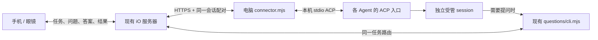

# CLI 与 ACP 统一接入

更新：2026-10-27。开发入口已实现；具体验证以 [本批证据](./acp-proof-2026-10-27.json) 为准。

Codex 保留原生会话框的接入已另增 [Desktop 同会话模式](./codex-desktop-shared.md)：同一原 native ID、桌面唯一持有者、手机忙时排队，避免 ACP 常驻独占。它依赖桌面运行和已核对版本；用户已批准本条会话工作区可写，CLI help/daily及语音回答回原任务通过。以下 ACP 独立受管模式继续用于 Claude/其他 Agent，不据此声称任意原 Desktop 聊天都已接管。

电脑连接器复用现有服务器、扫码/字符串配对、手机任务页及眼镜问答。不同 Agent 通过显式配置的 ACP 程序接入，手机不用分别实现每家的执行协议。



## 程序位置与身份

| 文件 | 职责 |
| --- | --- |
| `rebuild/agent-bridge/connector.mjs` | 初始化、配对、常驻收发和退出 |
| `hosts/acp-session.mjs` | ACP v1 握手、新建/恢复、输入、结果、权限和取消 |
| `hosts/native-runtime.mjs` | 复用耐久任务控制器，将权限请求接回原任务 |
| `questions/cli.mjs` | 沿用 Agent 主动提问、进度、回答和真实宿主身份校验 |
| 手机 `TaskSessionDirectory` / `TaskTargetUI` | 沿用现有任务页，识别通用 ACP 会话 |

初始化生成明确标为 `managed:true` 的路由 UUID。原 Agent 返回的真实原生 session ID 单独保存在电脑私有账本；两者并非同一标识。原生日志和上下文仍由 Agent 持有。CLI 只有核对到真实宿主 ID 与账本匹配，才允许映射到这条受管路由。

这条路径创建自己的受管会话，**当前 Codex Desktop 原聊天仍不能被远程接管**。它也不能仅凭安装 WorkBuddy 就控制 WorkBuddy 窗口里的任意已有对话。日常 Desktop 启动链保持原样；已停用的全局 `CODEX_CLI_PATH` 集成不可恢复。

## 运行

要求 Node.js 22.18+、能联网的现有手机账号及一个支持 ACP v1 `loadSession` 的本地程序。受管连接器自身不需要 Python；普通问答 CLI 的既有 Python 依赖仍保留。

当前实际验证的 macOS 依赖版本：

```sh
npm install --prefix /absolute/local/adapters --ignore-scripts --no-audit --no-fund \
  @agentclientprotocol/codex-acp@2.3.0 \
  @agentclientprotocol/claude-agent-acp@0.97.0
```

沿用相应官方引擎的正常登录。先用其官方登录流程配置账号，连接器不会从另一个 App 抽取内部访问密钥。不要把凭据放进命令参数或分享包。

从项目根目录初始化，JSON 通过标准输入传入（替换所有示例绝对路径）：

```sh
node rebuild/agent-bridge/connector.mjs init --directory /absolute/private/my-codex <<'JSON'
{"runtime":"codex","label":"我的受管任务","workspace":"/absolute/workspace","command":["/absolute/node","/absolute/local/adapters/node_modules/@agentclientprotocol/codex-acp/dist/index.js"]}
JSON
node rebuild/agent-bridge/connector.mjs pair --directory /absolute/private/my-codex
```

Claude 用 `runtime:"claude-code"` 和 `@agentclientprotocol/claude-agent-acp/dist/index.js`。输出包含二维码 HTML 与一次性配对字符串。手机进入「电脑连接 → 添加 Agent 会话」，扫码或粘贴，核对 Agent、主题、工作区和会话后「保存并绑定」。然后运行：

```sh
node rebuild/agent-bridge/connector.mjs pair-status --directory /absolute/private/my-codex
node rebuild/agent-bridge/connector.mjs run --directory /absolute/private/my-codex
```

终端保持运行时，手机可选择这条在线会话提交任务；结果回到原任务。Ctrl+C 退出连接器和自己启动的引擎；下次同一目录 `run` 恢复原生上下文。`status` 只读本地账本，不能把旧本地状态当作服务器仍在线的证明。

`init` 只保存配置，不启动引擎。`run` 建立或恢复原生会话，但不会自行发送模型输入。有些 Agent 不持久保存零轮次空会话，因此在首次输入意图落盘时才保存原生 session ID。进行过任务后，保留整个私有目录；删除账本不能解决执行状态不明，也不要把它打包给另一台电脑。

已有同一电脑配对可显式 `run --device /absolute/private/device.json`。正式使用按电脑一次扫码/字符串配对，后续新会话自动复用；同一路由一旦被服务器绑定到某个设备身份，不能拿另一份配对凭据抢用。问答 CLI `join` 在受管会话里由连接器负责常驻，不再启动第二个监听器。

## 权限、停止和恢复

- 需要批准的原生工具操作通过同一任务的问答显示完整标题与输入，只提供「仅允许本次 / 拒绝本次」。超出可完整显示的范围、超时或不支持的权限类型取消请求，不自动批准长期权限。原引擎既有权限设置仍由原引擎管理。
- 每条输入先保存耐久意图，再送到 ACP。未知执行、断线或丢失回执只对账，不重发模型输入；`session/load` 回放的旧内容不作为新任务结果。
- 结果来自同一条 `session/prompt` 的终态及文字输出。拒绝、失败或权限取消不会显示任务完成。
- 打断指向连接器当前唯一活动轮次，发 ACP `session/cancel`。**ACP 取消不能证明后台工具/远程工作全部停止**，本版保留「停止未确认」，不会放行“已证实停止后继续”。已有原生 Claude/Codex 专用控制器的停止证据机制保留。
- macOS 连接器退出会清理自己新建的本地引擎进程组，不结束日常 Desktop 或其他会话。连接器恢复不会自动执行状态不明的旧输入。

## WorkBuddy 目前的位置

已检查本机 WorkBuddy **5.8.3**，内置 CLI 报 **2.161.0**。直接运行内置 CLI 帮助会缺少普通 bundle；指定它自己的 lite bundle 能读帮助，但 ACP 握手前退出。本次未修改 App 安装包或使用其内部 Gateway 凭据。

官方独立 **CodeBuddy CLI 2.177.0** 在隔离配置中完成 `initialize`，`session/new` 返回需要认证。因此原生 ACP 入口成立，真实模型/恢复/手机控制尚待官方 CLI 登录后验证；它并不证明 WorkBuddy Desktop 原会话已可控制。独立 CLI 的官方安装与共存配置见[安装说明](https://www.workbuddy.ai/docs/zh/cli/installation)，ACP 用法见[官方文档](https://www.workbuddy.ai/docs/zh/cli/acp)。

WorkBuddy 的[连接器](https://open.workbuddy.cn/docs/connector)用于让 WorkBuddy 调用外部工具（MCP＋Skill 或 CLI＋Skill）；[云端 ACP/Open API](https://open.workbuddy.cn/docs/openapi)则另需第三方应用授权。现有问答 ZIP 保留 CLI 工具接入方式；本批没有实现云端 OAuth 或读取本机内部令牌。

## 使用代价与限制

电脑须开机、联网并保持连接器进程运行；每个受管会话会启动相应引擎，增加内存和常驻连接。模型调用使用原 Agent 账号额度和收费方式，恢复长上下文也可能计费。最初交付只提供前台运行；用户随后要求手机在线可用后，已补装下面的两条正式用户级自启服务。

统一的是任务、问答和结果通道，各 Agent 的登录、工具权限和 ACP 差异仍需适配与固定版本。已验执行平台是 macOS；Windows/Linux 只完成源码打包兼容准备，尚未做 ACP 真机验收。眼镜双击主动采音入口另项仍未完成，不从手机通过推定眼镜入口已通过。

dev136 手机登记上限仍为 16；可明确移除已暂停或到期的非当前/非默认登记，历史邮箱保留。以后同一会话重新登记可找回历史；这是本地登记管理，不撤销电脑授权，也不停止电脑任务。

## 已安装的正式常驻服务

用户要求手机可用后，已将正式连接与临时QA分开。当前Mac保留：

| 手机目标 | 本机工作区 | 用途 |
| --- | --- | --- |
| Codex · 手机工作区（默认） | `~/Documents/iO Agent/Codex` | 独立长期受管会话 |
| Claude Code · 手机工作区 | `~/Documents/iO Agent/Claude` | 独立长期受管会话 |

核心程序安装在 `~/.turboio/connector-runtime`，固定版本适配器在 `~/.turboio/acp-runtime`，不会依赖临时目录、当前工具调用或开发工作树继续存在。配置/账本位于 `~/.turboio/connectors/codex-phone` 和 `claude-code-phone`；不要删除这些目录来恢复连接。复用已有电脑与手机长期配对，不需每天重新绑定。服务器默认从原来的空目标设为正式Codex；手机临时选择Claude不改默认。

macOS用户级LaunchAgent以独立进程保持连接，登录自动启动、退出后由系统重启；电脑关机、睡眠或断网时仍会离线。已实测停止/启动两条服务后恢复同一个原生session并读回原上下文；没有重启电脑或重新登录实测。此机制不影响ChatGPT/Claude Desktop自身启动，也不会接管当前Desktop原聊天。

显式管理入口（通过稳定安装副本运行；将Codex路径换成Claude路径可管理另一条）：

```sh
node "$HOME/.turboio/connector-runtime/tools/collab/connector-service.mjs" status --directory "$HOME/.turboio/connectors/codex-phone"
node "$HOME/.turboio/connector-runtime/tools/collab/connector-service.mjs" start --directory "$HOME/.turboio/connectors/codex-phone"
node "$HOME/.turboio/connector-runtime/tools/collab/connector-service.mjs" stop --directory "$HOME/.turboio/connectors/codex-phone"
```

实际已装服务使用稳定安装副本 `~/.turboio/connector-runtime/tools/collab/connector-service.mjs` 管理；`start`重复调用不会重启已运行的任务，配置位置改变需先明确停旧服务再更新。`stop`移除该服务的登录自启并结束自有引擎，正在执行的任务可能变成待核对；账本与历史保留，原生状态不明的任务不自动重发。进程存活不等于可执行，手机仍以真实宿主和服务器租约为准。

Claude的现有供应商认证来自原终端环境，后台服务不会自动继承。只保存白名单中的现有Claude配置到该配置目录的私有`service-env.json`（0600），worker读取后交给同一官方引擎；不写进plist、仓库、分享包或全局环境。更新这些配置后，正常停止/启动服务即可重新取当前终端配置。首次遗漏环境导致的401自检保留为失败记录，原未知输入不重放；修正后使用新的正式会话通过了真实执行与恢复。

本次正式服务在交付后继续运行，不纳入QA撤销。WorkBuddy仍需独立官方CLI的正常认证验收。

## 2026-10-27：电脑配对与 Agent 主动投送

电脑授权保存在用户目录 `~/.turboio/agent-device.json`。新的 profile 直接 run，不重复要求手机批准。新二维码/字符串带显式 `mode:computer`，手机确认授权这台电脑后续使用 CLI 的会话；历史 session-only 授权不扩大。续期仍是短期访问令牌＋长期可撤销电脑配对，不向二维码暴露续期密钥。

受管任务每轮自动带 `IO_AGENT_CLI_ARGS`。Agent 运行该命令的 notify/ask/wait/status 即可主动投送；上下文指向原手机 task、真实 native session 和这一轮，回答可直接继续原任务。无需另跑 join，不新建替代任务，不依赖 Python。普通问答 CLI 的新会话首次 ask/notify/checkpoint 自动 join，也可先 join 设置主题。

实际 Codex 工具沙箱禁止联网，因此 CLI 只向工作区 `.io-agent-cli/<turn>` 写本地命令，已有连接器转发到服务器并回传结果。没有更改 Agent 的网络、文件、模型、审批或 Desktop 启动设置；两端各按100毫秒轮询，网络耗时另计。电脑离线或连接器退出时命令会明确超时，不谎报已显示。每轮命令和回执为小型本地状态，未知输入不会重放。

当前普通 Desktop 聊天仍不支持该受管执行入口。2026-10-27 用户要求将主聊天设为默认，读取真实 App 与监听器后，原会话只在 App 私有 stdio owner 加载，共享 listener 报 CODEX_SESSION_NOT_LOADED，设置默认返回 DEFAULT_SESSION_UNAVAILABLE。没有改变共享默认，也没有将另一个手机工作区冒充主聊天。已清理22条过期/已释放测试目录行，留可恢复备份；实际目录、资料和聊天不删除。

### 空闲收件（2026-10-30）

支持 `inbox_watch_v1` 的服务器上，同一电脑配对的连接器与会话监听共用一个 10 秒长轮询（低于现有网关 15 秒上限）。队列提交后立即通知，静默时只续接等待；通知只含变化标记，各会话仍按原持久游标读取。跨进程通过私有标记文件与现有 OS 文件锁协作，监听退出后其他进程接替；不同凭据/账号不混用。会话的原生执行、打断和结果循环不因网络等待而阻塞。无通知能力沿用旧通道；监听故障退回最多每 15 秒检查，健康时每分钟补查一次。配对撤销仍按正式授权错误停止。

在线目录的 15 秒续租保留，但已知租约不再每次先 GET 全目录。手机主设备的短租约仍保持，以避免换机双重投送。代价是每个配对的监听占用一个等待中的 HTTPS 连接及小型本地标记文件；不新增模型调用，不改 Desktop 启动环境。
