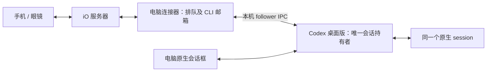

# 原生 Codex 同一会话入口

2026-10-27 用户选定保留原生 Codex 会话框，电脑文字、手机语音与眼镜回复进入同一 session；忙时可以排队。无需网页聊天。

- `connector.mjs` 的私有 profile 可显式设 `control_mode: "desktop"`。沿用原 route 与 `acp.json` 中已经验证的原生 session ID，不创建另一条聊天。
- `hosts/codex-desktop-shared.mjs` 保存每条手机任务的原 task/native session/operation 与 CLI 绑定；后台连接器不再启动 ACP 模型进程占用聊天。
- `hosts/codex-desktop.mjs` 向实际桌面持有者发送输入并跟随原生状态流；请求继承当前模型及权限，不带权限覆盖。正常忙碌时在本地耐久队列等待。桌面恰好同时提交时，由原持有者决定同会话补充行为，不声称原子空闲锁或原生队列追加。
- 短 CLI 入口通过 `additionalContext` 的 `application` 内容提供，完整命令 schema 按需 `help`。普通用户消息只有实际输入；旧历史消息不重写、不删除。
- 工具只拿工作区 `.io-agent-cli/<固定 operation>/context.json`，其中不含凭据、服务器配置或私有账本。连接器校验原始绑定并负责联网；完成后的上下文关闭，不指向后续任务。只向原任务发布该 turn 的 `final_answer`，不把 commentary 当结果。

## 本次原会话验证

正式 route `85ddd5a4-c238-4c3e-8a24-d5ef9cc04d30` 仍指向原 native `01a17d09-d939-78b1-ac2e-d601a8f7a544`（连接自检与回执）。桌面入口写入的 `IOSHARED-1027` 被 follower 提交的下一条输入准确读回。桌面工作期间向服务器提交两条手机任务，两条先等待，再按顺序完成 `PHONE-QUEUE-1`、`PHONE-QUEUE-2`，各有独立原生 turn。App read_thread 证实新用户消息未包含完整 CLI 教程。

首次实测启用 `useUserMessageAdmission` 收到“User-message admission requires a cloud app-server host”，因此本地桌面请求不设置该 cloud admission 开关；保留失败证据，不将它宣称为可用队列协议。丢失回复只按原 operation 对账，不自动重投。

## 当前权限前置与代价

最初原生会话 `currentPermissions` 为 `:read-only`、`approvalPolicy: on-request`、不联网，拒绝邮箱写入（EPERM），只读本机 Unix socket 探测也被拒绝，且本会话未提供 `request_permissions` 工具。上述失败已保留。

用户随后明确选择“改为工作区可写，继续验完CLI”。只对本条原生会话调用原持有者的 `thread-follower-update-thread-settings`，工作区 `~/Documents/iO Agent/Codex`；网络继续关闭，并排除通用临时目录写入。不改全局配置；原生自动保留本 session 专属的可视化输出目录。该权限会允许 Agent 修改工作区文件，不能称为只开放邮箱。后续原生工具实际执行 help 和 daily 成功，读到5个日期且保留 IOSHARED-1027。工作区客户端无私有账本读取权限的独立 Node 权限测试也通过。

双向问答任务 `codex-shared-two-way-6e55f971-443` 只创建一个请求、两次等待同一 request；Android语音回答 `option_id=ok`、原话“选一。\n符合预期。”回到同一原生 turn，原任务 completed。未改写旧大段说明历史，没有额外批量提词器。完整证据见 [本批核对](./codex-desktop-shared-proof-2026-10-27.json)。

电脑必须醒着联网，桌面版保持运行并加载原会话。CLI 0.2.3 起不再按 App 版本或安装源码哈希拒绝接入：连接时实际初始化、找到当前原持有者、核对输入能力、读取设置并验证该 session 的状态。入站状态版本数字升级但结构仍兼容时接受；`codex-desktop-profile.json` 的出站方法版本是协议参数，不是 App 白名单。

此接口仍是桌面内部协议；未来真的改变方法或状态结构时，按具体协议、原持有者、设置或状态错误停止，需要适配时再更新 CLI。执行命令只发送一次，回执不明仍按原操作核对，不能因兼容失败换会话或重发。没有恢复 `CODEX_CLI_PATH` 或全局 daemon 变量，没有修改日常 App 启动链。

原生输入框视觉解锁和用户日常多端体验继续由 A27-S05/S06 跟踪，不用服务器接收或 App 状态冒充人工观察；本轮确实收到Android语音回答，但未独立观察镜片显示。正式 Claude 服务、电脑配对、默认目标与手机 dev139 保留。本批迁移只针对已绑定的85ddd5原会话；其他普通Desktop会话自动接入不据此宣称全部完成。
